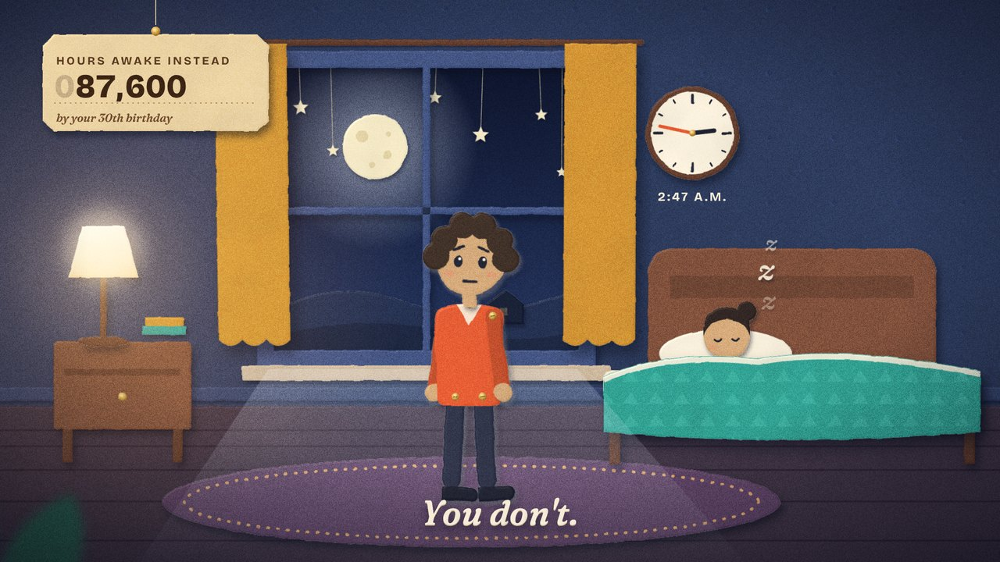
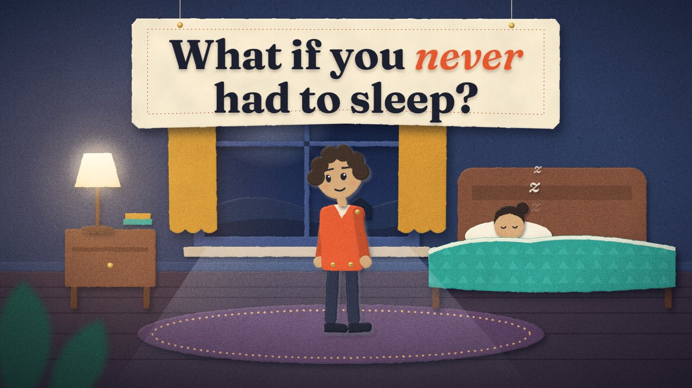
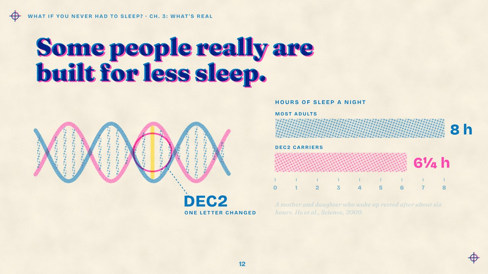
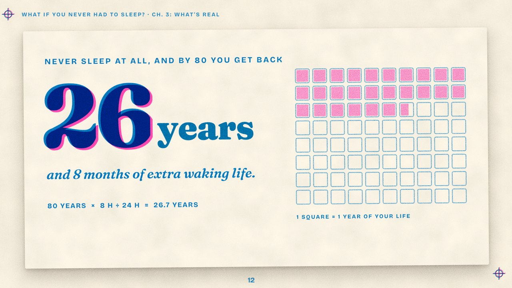
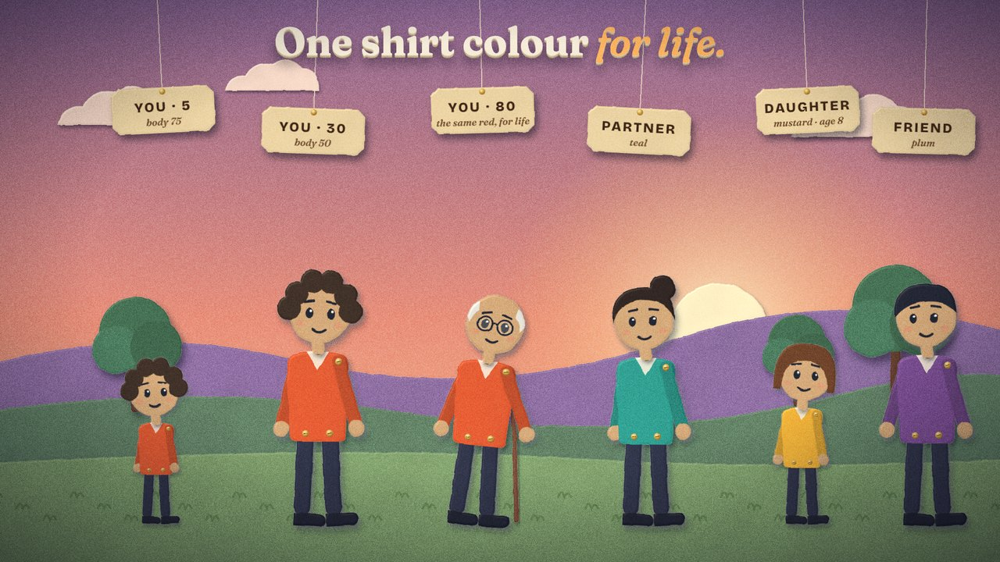

# Paper Theatre: house style for the long-form What If videos

The reference video is warm flat vector: black stick figures, sunset windows, and a navy-grid science mode. Our answer is **a toy theatre made of card**:

- Every story scene is a lit cut-paper diorama with real depth.
- Every science beat is a page printed on a risograph.
- The two are joined by a page turn.

It is the same two-world structure that makes their video work, in a look nobody else in the niche has.

| | Style frame |
|---|---|
| Story world (night) |  |
| Title banner |  |
| Riso science page |  |
| Payoff card |  |
| Cast and aging |  |

The proof clip is 16.5 s from an original script ("What if you never had to sleep?"). Build it with:

```bash
cd whatif && npm install && npm run proof
```

The output goes to `renders/whatif_proof/video.mp4`.

## Where we beat the reference (measured the same way)

| | Reference ("aged backwards") | Our proof clip |
|---|---:|---:|
| Frames with essentially no motion | 54% | **1.8%** |
| Longest still hold | 6.7 s | **0.13 s** |
| Resolution | 1280×720, letterboxed to about 2:1 | **1920×1080, full frame** |
| Depth | Flat; one blur layer on close-ups | **8 parallax planes, cast shadows, depth-of-field foreground** |
| Texture | Grain overlay | **Card fibre, hand-cut edges, bevel light, riso speckle, film grain** |
| Characters | Black stick figures, dot eyes | **Split-pin paper puppets with brows, blinks, cheeks and hair, one shirt colour each for life** |
| Loudness | −14.1 LUFS | −13.8 LUFS |

## The two worlds

### 1. Story world: the diorama

- **Planes.** Every scene is 6–9 card planes at fixed depths: wall 0.5, window 0.6, clock 0.62, curtains 0.66, lamp 0.8, floor 0.85, bed 0.9, puppets 1.0, foreground 1.5.
  - The camera always moves. It pushes 5–8% and drifts 40–60 px per shot, and each plane moves by its depth.
  - Never hold a frame still.
- **Card.** Every plane gets one of the `card0`–`card3` filters in `whatif/lib/stage.js`. Each adds fibre texture, a hand-cut edge wobble, a bevel catching light from the upper left, and a cast shadow that grows with depth gap.
  - The key light is always the upper left. Practical lights (lamp, moon, sun) add glow on top with `screen`; they never move the shadows.
- **Atmosphere** in every shot:
  - one warm or cool practical light;
  - a vignette;
  - film grain (six pre-baked tiles, cycled per frame);
  - something that sways on a thread: stars, tags, the title banner;
  - an out-of-focus foreground element at a frame corner.
- **Palettes:**
  - Night: wall `#263457`, sky `#0e152d`→`#26365f`, lamp `#ffb45e`, moon `#f3e7c4`.
  - Dusk: sky `#6d5a9c`→`#e98f7a`→`#ffd59a`, hills `#8b6aa0` / `#5f7f63`.
  - Interiors use kraft `#d4a777`, wood `#7b4a36` and cream `#f6ecd9`.

### 2. Science world: the riso page

- **Paper and ink.** Cream paper `#f3ebdb`, two inks only: riso blue `#0078bf` and fluorescent pink `#ff48b0`. Yellow `#ffd400` is reserved for the one thing the viewer must find.
- **Misregistration.** Both inks print with `mix-blend-mode: multiply`, so overlaps go navy. The pink pass always sits 4–5 px out of register.
- **Fills** are halftone dot patterns (`dotsBlue`, `dotsPink`), never flat gradients. The `ink` filter adds starved-ink speckle.
- **Book furniture** on every page:
  - a running header ("What if you never had to sleep? · ch. 3: what's real");
  - a page number;
  - registration marks in two corners.

  This tells the viewer the science is "the real book" behind the story.
- **New facts arrive as cards.** A new card slides up over the page with a soft shadow; nothing fades in on a void.

### The page turn

The diorama is the front of a page hinged on the left edge of the frame. It swings away with `inOutSine` over 0.8 s, darkening as it turns, and casts a shadow that sweeps across the page beneath. Use it only when switching between story and science. That keeps it meaningful, like their warm/cool switch.

## Type

| Role | Face | Spec |
|---|---|---|
| Title banner, story key lines | Fraunces 700, accent word in Fraunces 600 italic | Ink on a cream card; accent in the protagonist's colour |
| Floating key lines over the diorama | Fraunces 600 italic | Cream with a 2 px card edge and a soft shadow |
| Riso headlines | Fraunces 900 | Two passes, pink offset 5 px |
| Labels, HUD, axes | Bricolage Grotesque 700/800 | Caps, tracking 0.12–0.18 em, tabular numbers |
| Sources and footnotes | Fraunces 600 italic | Blue, at 24 px minimum |

The fonts are OFL-licensed and installed from npm (`@fontsource/fraunces`, `@fontsource/bricolage-grotesque`).

**How text moves:**

- In the story world, glyphs **fold up off the card** like pop-up-book tabs. Each is a spring on `rotateX`, staggered 22 ms apart, and they fold back down to leave.
- On riso pages, words **stamp in**. They scale from 1.16 to 1 while the pink pass slides into near-register.
- Never fade text in plainly.

## Characters: split-pin puppets

The builder is `PT.puppet()` in `whatif/lib/stage.js`.

- **Construction.** A card torso, limbs rotating on visible brass split pins, and a kraft head on a neck pin.
  - The limited joints are the charm and the reason animation stays cheap: every move is a rotation about a pin.
- **Identity.** One shirt colour per person for their whole life:
  - you `#e4572e`
  - partner `#2a9d8f`
  - child `#f2b134`
  - friend `#7b4b94`
  - elder or parent `#5aa9e6`

  Sleeves are the shirt colour 16% darker, so arms read against the torso.
- **Age is drawn, not labelled:**
  - **Head scale:** `hs` 1.3–1.4 for children, 1.0 for adults.
  - **Hair:** colour, then style. `thin` + white for the elderly.
  - **Glasses.**
  - **Posture:** `lean` 5–8° for the elderly.
  - **Props:** cane, stick, school bag.

  The HUD ticket carries the number.
- **Face.** Brows carry the emotion; mouths stay small. Blink every 2–4 s (`blink`), and turn the eyes (`look`) toward whatever the narration names.

## The HUD: hanging tickets

The reference's AGE/BODY box becomes a kraft tag hung on a string from a brass pin.

- It drops in on a spring, swings, and settles.
- Numbers are a **mechanical odometer** (`PT.odometer`): every column turns with a true carry, with vertical motion blur when spinning fast.
- Every counter value is computed from the same timeline that drives the picture and the sound.

## Sound

**Narration** comes first. Gemini 3.8 Flash TTS, voice `Algieba`:

- Generate it with `python -I gemini_tts.py say Algieba SCRIPT.txt OUT.wav`, run from `buh-essays/voice`. That also writes word timings.
- The free tier is about 10 requests a day. The longest single request so far returned 87 s of audio. Generate an episode one chapter per request, which keeps retakes cheap; a 6-minute episode is about 5–6 requests.
- Scenes read the word timings from a `*_vo.js` file and put each beat on the word that calls for it. The clock stops on "two forty-seven", and the 26-year counter lands on "twenty-six".
- The audio script puts the bed and foley 16 dB under the voice and ducks them about 5 dB more while it speaks.

Everything is in `whatif/proof/never_sleep_audio.py`, built on the existing `shorts/engine.py` mixer.

- **Paper foley on every cue the scene exports** (`window.CUES`):

  | Event | Sound |
  |---|---|
  | Glyph pop | Tab click |
  | Banner or ticket | Flap |
  | Odometer | Ticks (one per thousand) |
  | Page turn | Whoosh |
  | Riso word | Stamp thud |
  | Helix draw-on | Pencil scratch |
  | Bars | Riser |
  | Squares filling | Plucks climbing a pentatonic ladder |
  | Payoff | Chime |

- **Bed:** a music-box lullaby in the story world and a plucked arpeggio on riso pages, both at 80 BPM. With voice-over, keep the bed about 13 dB under the voice (the reference sits at 13.5 dB).
- **Master:** −14 LUFS.

## Production rules

1. `seek(t)` is pure. No CSS animations, timers or `Math.random` (use `PT.rng(seed)`), so any frame renders identically on any worker.
2. Sounds come only from `CUES` pushed from the timeline constants (`T` in each scene).
3. Never hold a frame. Motion floor per shot:
   - camera drift;
   - one swaying element;
   - one breathing or blinking puppet.
4. One idea per visual. If the narration says three things, cut three times. The reference's triads ("wrinkled skin, white hair, bad knees") each get a cutaway.
5. Every number on screen is computed. The proof's 87,600 hours is 30 × 365 × 8; its 26 years 8 months is 80 × 8 ÷ 24. The 26 squares and the counter are driven by the same fill times.

## Rendering

`whatif/render.cjs` drives headless Chromium (the pre-installed Playwright) frame by frame and pipes PNGs into x264 at CRF 14, in parallel segments.

| Command | What it does |
|---|---|
| `node render.cjs proof/never_sleep.html OUT_DIR --stills 2.6,5.9` | Stills, about 1 s each |
| `node render.cjs proof/never_sleep.html OUT.mp4 --jobs 3 --audio proof/never_sleep_audio.py` | Full render, about 0.75 s of wall time per frame with 3 workers |

**Speed.** The proof (396 frames) takes about 5 minutes on 3 workers. A 6-minute episode (8,640 frames) would take about 1.8 hours on this 4-core machine as-is. The obvious speed-up, when episodes start: bake each static plane's card texture to a PNG once instead of recomputing turbulence every frame.

## What's next

- **Voice: done.** The narrator is Gemini 3.8 Flash TTS, voice `Algieba`, with the tuned prompt in `buh-essays/voice/gemini_tts.py`. It was picked by matching the reference narrator; the results are in `buh-essays/voice/RESULTS.md`. The narration is generated first; the scene's `T` timeline is then keyed to its Whisper word timings (`proof/never_sleep_vo.js`).
- **Scene kit.** Build one reusable set per location (bedroom, classroom, hospital, street, café), plus a riso kit for charts, timelines, the life grid and diagrams. A 6-minute episode is roughly 12 story scenes and 4 riso pages.
- **Thumbnail.** The title banner on its strings over a lit diorama, with the protagonist's face at 1.5× scale. Test it against the reference's style in a mock search grid.
